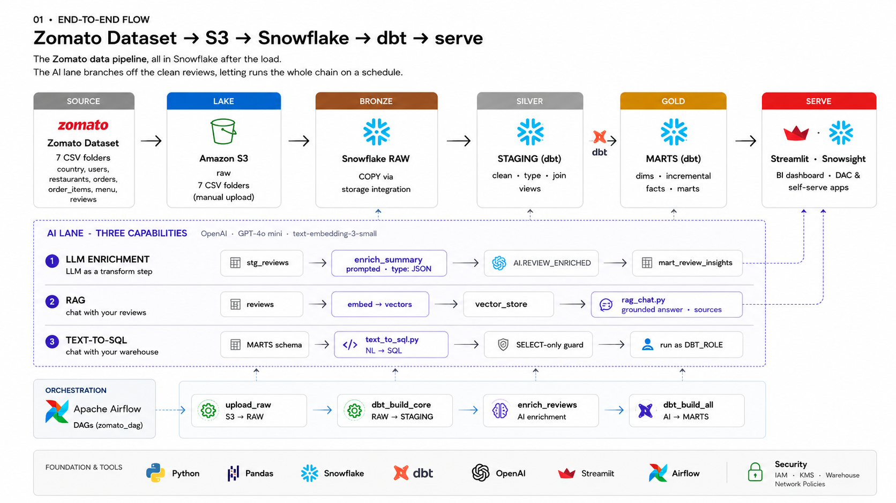
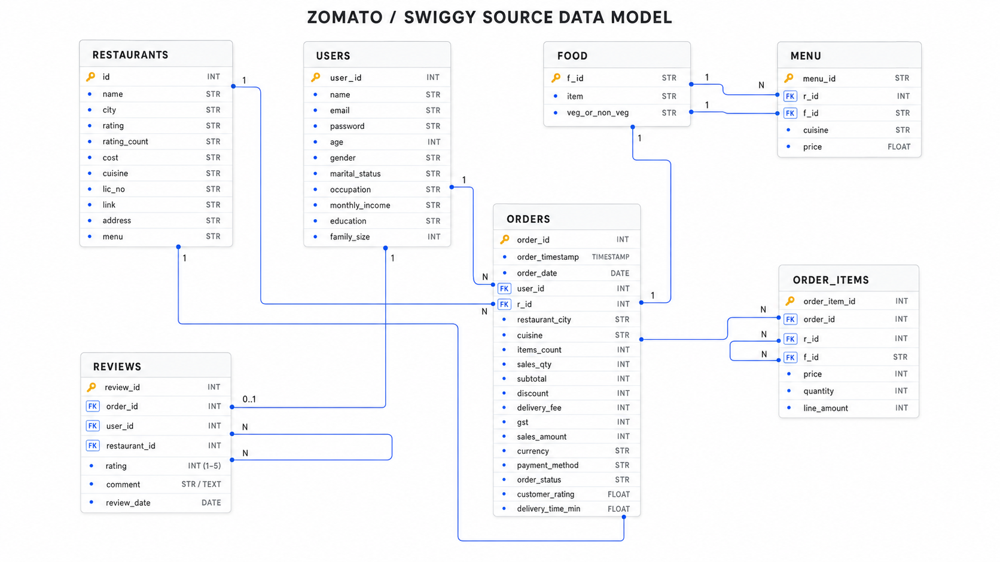
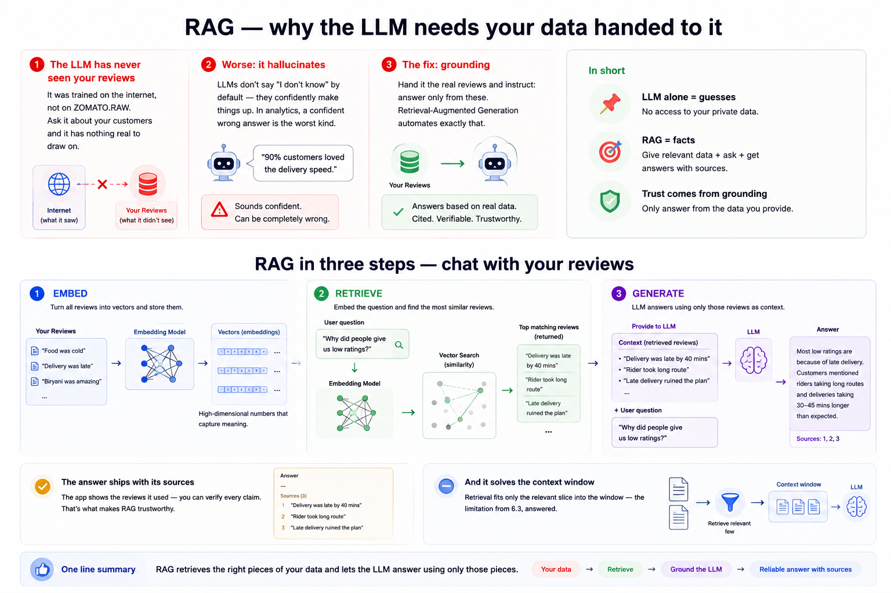

# Food Delivery Intelligence Platform | End-to-End Data Engineering & AI Analytics (Zomato Dataset)

A batch data pipeline that takes Zomato-style food-delivery data from raw CSVs to an AI-powered warehouse:

**Zomato dataset → Amazon S3 → Snowflake → dbt → Airflow → Azure AI Foundry (DeepSeek V4 Flash, GPT-5.6 Luna)**

The CSVs land in S3 and load into Snowflake through a storage integration. dbt then moves them through medallion layers:

- **RAW (Bronze):** tables loaded **incrementally** with `COPY INTO`.
- **STAGING (Silver):** cleaned, deduplicated views.
- **MARTS (Gold):** dimensions, incremental fact tables built with `MERGE`, and aggregate marts.

Airflow runs the whole chain as one DAG.

On top of the warehouse sits an AI lane with three parts:

- **LLM enrichment** turns free-text reviews into queryable columns.
- **RAG** lets you chat with the reviews.
- **Text-to-SQL** answers plain-English questions over the marts. Guardrails stop it from running anything but safe, read-only queries.



> The diagrams come from the course deck in [`docs/`](docs/zomato-ai-data-engineering-curriculum.pptx), which explains every layer in detail. The deck labels the AI lane with OpenAI. This repo runs the same three capabilities on Azure AI Foundry deployments instead (see [AI layer](#ai-layer)).

## What gets built

| Layer | Where | What |
|---|---|---|
| **Source** | CSV files | 4 real dimension files (restaurants, users, food, menu) and 3 generated fact files: **10M orders**, **~23M order items**, **300K free-text reviews** |
| **Lake** | `s3://zomato-data-dump/raw/<table>/` | One prefix per table. New batches arrive as **new files**; existing files are never overwritten |
| **Bronze** | Snowflake `ZOMATO.RAW` | `COPY INTO` with lineage columns `_source_file` and `_loaded_at`. Already-loaded files are skipped |
| **Silver** | Snowflake `ZOMATO.STAGING` | 7 dbt views that clean, type and rename each source and keep the latest row per business key |
| **Gold** | Snowflake `ZOMATO.MARTS` | Dimensions, incremental facts (`MERGE` on a load-time watermark), business marts |
| **AI** | Snowflake `ZOMATO.AI` and Streamlit | LLM-enriched reviews, RAG chat, guarded text-to-SQL |
| **Orchestration** | Airflow 3 (Docker) | One DAG: load → transform → enrich → AI marts |

## Tech stack

Python 3.12 · uv · Amazon S3 · Snowflake · dbt (dbt-snowflake) · Apache Airflow 3 (Docker) · Azure AI Foundry (DeepSeek V4 Flash, GPT-5.6 Luna, text-embedding-3-small) · OpenAI Python SDK · sqlglot · Streamlit · pytest

## Repository structure

```
├── snowflake_queries.txt        # Snowflake setup, one-time migration, incremental COPY, checks
├── airflow/                     # Airflow 3 on Docker
│   ├── Dockerfile               #   Snowflake provider, dbt in its own venv
│   ├── docker-compose.yaml      #   postgres + api-server + scheduler + dag-processor
│   └── dags/zomato_batch.py     #   the pipeline DAG (4 tasks)
├── zomato_pipeline/             # dbt project
│   ├── models/staging/          #   7 staging views (Silver) + sources + tests
│   ├── models/marts/            #   dims, incremental facts, business marts (Gold)
│   └── macros/                  #   custom schema-name macro
├── zomato/profiles.yml          # dbt connection profile (gitignored)
├── ai/                          # AI layer
│   ├── enrich_reviews.py        #   hash-cached LLM enrichment → ZOMATO.AI.REVIEW_ENRICHED
│   ├── chatbot.py               #   RAG: "chat with your reviews" (Streamlit)
│   ├── text_to_sql_bot.py       #   text-to-SQL: "chat with your warehouse" (Streamlit)
│   ├── sql_guardrails.py        #   AST-based SQL validation (allowlists, PII, row cap)
│   └── test_sql_guardrails.py   #   37 guardrail tests
├── docs/                        # course deck + diagrams
└── pyproject.toml               # uv-managed Python dependencies
```

## Source data model



| Table | Rows | Grain |
|---|---:|---|
| `orders` | 10,000,000 | one order |
| `order_items` | 22,998,179 | one line item (order × food item × quantity) |
| `reviews` | 300,000 | one free-text review per order (the AI input) |
| `menu` | 1,178,664 | one food item on a restaurant's menu (`menu_id` + `f_id`) |
| `food` | 371,561 | one food item |
| `restaurants` | 148,541 | one restaurant |
| `users` | 100,000 | one customer |

## The pipeline

`airflow/dags/zomato_batch.py` runs four tasks in order:

```
reload_raw  →  dbt_build_core  →  enrich_reviews  →  dbt_build_ai
```

| Task | What it does |
|---|---|
| `reload_raw` | Runs `COPY INTO` for each of the 7 RAW tables. Only files that haven't been loaded yet land |
| `dbt_build_core` | `dbt build --exclude tag:ai`: staging views, dims, incremental facts, marts, and every test |
| `enrich_reviews` | Labels new or changed reviews in `ZOMATO.AI.REVIEW_ENRICHED`. Each distinct text is classified once by DeepSeek V4 Flash (at most `SAMPLE_N` new texts per run), and labels are reused from a hash-keyed cache |
| `dbt_build_ai` | `dbt build --select tag:ai`: `mart_review_insights` (sentiment × topic per city) |

Every task can be re-run safely. A retry never duplicates rows and never pays for the same review twice.

### Incremental loading

Each layer only processes what is new:

1. **S3 → RAW.** Snowflake keeps load metadata for each table for 64 days, and `COPY INTO` skips files it has already loaded. Each row records the file it came from (`METADATA$FILENAME`) and when it was loaded (`METADATA$START_SCAN_TIME`). Three rules keep this working:
   - Write each batch as a new file, e.g. `raw/orders/2026-10-25/orders_001.csv`. An overwritten file counts as new and gets reloaded in full.
   - Never `CREATE OR REPLACE` or `TRUNCATE` a RAW table. Both wipe the load metadata, so the next run reloads every file.
   - Dimension tables load with `ON_ERROR = 'CONTINUE'`, which skips bad rows. Fact tables use `ABORT_STATEMENT`, which fails the load.
2. **RAW → STAGING.** Each staging view keeps the latest row per business key, using `QUALIFY ROW_NUMBER() ... ORDER BY _loaded_at DESC`. So a corrected record in a later file wins, and a re-sent file can't create duplicates. `stg_menu` is keyed on `(menu_id, f_id)`, because one menu lists many food items.
3. **STAGING → MARTS.** `fact_orders` and `fact_order_items` are incremental `MERGE` models. Each run picks up rows whose `_loaded_at` is newer than anything already in the fact table. Filtering on load time rather than `order_timestamp` also catches late-arriving orders and status changes (Cancelled → Refunded) that keep their old timestamp. To rebuild from scratch, run `dbt build --full-refresh`.

### dbt models

| Layer | Models |
|---|---|
| Staging (views) | `stg_orders`, `stg_order_items`, `stg_reviews`, `stg_restaurants`, `stg_users`, `stg_food`, `stg_menu` |
| Dimensions | `dim_customer`, `dim_restaurants`, `dim_food`, `dim_date` (date spine from `generator()`) |
| Facts (incremental) | `fact_orders`, `fact_order_items` |
| Marts | `mart_daily_city_revenue`, `mart_restaurant_performance`, `mart_delivery_sla` (p50/p90 delivery time) |
| AI mart (`tag:ai`) | `mart_review_insights`: sentiment and topic per city, from `ZOMATO.AI.REVIEW_ENRICHED` |

Tests run as part of `dbt build`: `unique`, `not_null`, `relationships` and `accepted_values` on keys and statuses.

## AI layer

| Capability | Script | Model (Azure AI Foundry) |
|---|---|---|
| LLM enrichment | `ai/enrich_reviews.py` | DeepSeek V4 Flash |
| RAG chat | `ai/chatbot.py` | DeepSeek V4 Flash + text-embedding-3-small |
| Text-to-SQL | `ai/text_to_sql_bot.py` | GPT-5.6 Luna |

All three call Azure through the OpenAI SDK's v1 endpoint: `OpenAI(base_url=<AZURE_OPENAI_ENDPOINT>)`, passing the deployment name as `model`.

### 1. LLM enrichment: the LLM as a transformation step

Enrichment is incremental and keyed on a hash of the review text. 300,000 reviews contain only 294 distinct texts, so each text is sent to the model once and its labels are reused for every review with the same text.

1. **Hash.** Each review in `STAGING.STG_REVIEWS` gets `comment_hash = sha2(lower(trim(comment)))`. A review is *pending* if `ZOMATO.AI.REVIEW_ENRICHED` has no row for it with that hash, which covers new reviews and reviews whose text changed.
2. **Reuse cached labels.** Labels live in `ZOMATO.AI.REVIEW_LABEL_CACHE`, one row per text and labeler. The labeler is the model name plus a hash of the system prompt, so editing either one re-classifies texts on later runs. A single `MERGE` copies cached labels onto all pending reviews. This step makes no LLM calls.
3. **Classify new texts.** Pending texts with no cached label are classified, at most `SAMPLE_N` distinct texts per run. The model returns JSON with `sentiment_label`, `sentiment_score`, `topic` (from a fixed list) and `key_issue`, and labels outside the allowed values are rejected. New labels are staged in a temporary table and merged into the cache, so a retried run can't duplicate them. Then step 2 runs again.

Unchanged reviews are never rewritten, and a re-run with no new text makes zero LLM calls. On the first run, the label cache is seeded from labels already in `REVIEW_ENRICHED`, so nothing that was already classified is paid for twice. The prompt caps each reply at about 100 tokens, and a reply cut off by `max_completion_tokens` raises an error instead of saving partial JSON.

### 2. RAG: chat with your reviews



1. **Embed:** all review comments are embedded once and cached in `review_embeddings.parquet`. Blank comments are dropped, because Azure rejects a whole batch if any input is empty.
2. **Retrieve:** the question is embedded and the top 5 reviews are picked by cosine similarity.
3. **Generate:** the model answers using only those reviews, and the app shows them as sources.

### 3. Text-to-SQL: chat with your warehouse, safely

The LLM writes SQL from a prompt that includes the real mart schema and business definitions. Before anything runs, the question and the SQL pass through several layers of checks:

| Stage | Check |
|---|---|
| Pre-generation hooks | Input check (control characters stripped, 500-character limit) and **intent classification**. Only `analytics` questions continue. Data changes, requests for personal data, prompt injection and off-topic questions are refused |
| Generation | Strict JSON-schema output. The model returns `{"sql": ""}` when the question can't be answered |
| Post-generation hooks | `sql_guardrails.validate_sql` parses the query with sqlglot's Snowflake dialect and requires all of these:<br>• exactly one statement<br>• `SELECT` only, with no write or command nodes<br>• only the 6 allowed mart tables and their columns<br>• no PII columns<br>• no `SELECT *`<br>• no blocked functions (`GET_DDL`, `RESULT_SCAN`, `SYSTEM$*` and others)<br>• a `LIMIT` of at most 1000 rows, added if missing |
| Execution | Runs as a **read-only role** (`TEXT2SQL_READER`) with a 30-second statement timeout and a query tag |
| Caching | Two in-process Streamlit caches. Question → checked SQL is kept 24 h, so repeat questions skip both LLM calls. SQL → result is kept 1 h, so repeat queries skip Snowflake. Blocked or failed questions are never cached |
| Audit | Every question, verdict and query is written as one JSON line to `text_to_sql_audit.log` (gitignored), including questions answered from the cache. Users only ever see generic error messages |

Run the tests with:

```bash
uv run pytest ai/test_sql_guardrails.py
```

## Setup

### Prerequisites

- A Snowflake account with warehouse `ZOMATO_WH`, database `ZOMATO`, and a `DBT_ROLE` service user
- An S3 bucket, plus a Snowflake storage integration (`ZOMATO_S3_INT`) that can read it
- Azure AI Foundry deployments of DeepSeek V4 Flash, GPT-5.6 Luna and text-embedding-3-small
- Docker, and [uv](https://docs.astral.sh/uv/)

### 1. Python environment

```bash
uv sync
```

### 2. Snowflake

Run [`snowflake_queries.txt`](snowflake_queries.txt) in Snowsight. It has four sections:

1. **One-time setup:** file format, stage, and RAW tables. It only uses `IF NOT EXISTS`, so it's safe to re-run.
2. **One-time migration:** adds the lineage columns to RAW tables created before they existed. It changes metadata only, and already-loaded files are not reloaded.
3. **Incremental load:** the same `COPY INTO` statements the DAG runs.
4. **Checks:** row counts, `COPY_HISTORY`, rows per source file, and duplicate keys.

Create the read-only role for text-to-SQL:

```sql
CREATE ROLE IF NOT EXISTS TEXT2SQL_READER;
GRANT USAGE ON WAREHOUSE ZOMATO_WH TO ROLE TEXT2SQL_READER;
GRANT USAGE ON DATABASE ZOMATO TO ROLE TEXT2SQL_READER;
GRANT USAGE ON SCHEMA ZOMATO.MARTS TO ROLE TEXT2SQL_READER;
GRANT SELECT ON TABLE ZOMATO.MARTS.FACT_ORDERS                 TO ROLE TEXT2SQL_READER;
GRANT SELECT ON TABLE ZOMATO.MARTS.DIM_RESTAURANTS             TO ROLE TEXT2SQL_READER;
GRANT SELECT ON TABLE ZOMATO.MARTS.DIM_CUSTOMER                TO ROLE TEXT2SQL_READER;
GRANT SELECT ON TABLE ZOMATO.MARTS.MART_DAILY_CITY_REVENUE     TO ROLE TEXT2SQL_READER;
GRANT SELECT ON TABLE ZOMATO.MARTS.MART_RESTAURANT_PERFORMANCE TO ROLE TEXT2SQL_READER;
GRANT SELECT ON TABLE ZOMATO.MARTS.MART_DELIVERY_SLA           TO ROLE TEXT2SQL_READER;
GRANT ROLE TEXT2SQL_READER TO USER <your_user>;
```

### 3. Credentials

Credentials never go in code. Both files below are gitignored.

| File | Variables |
|---|---|
| `ai/.env` | `AZURE_API_KEY`, `AZURE_OPENAI_ENDPOINT` (ends in `/openai/v1`), `SNOWFLAKE_ACCOUNT`, `SNOWFLAKE_USER`, `SNOWFLAKE_PASSWORD`, `SNOWFLAKE_WAREHOUSE`, `SNOWFLAKE_DATABASE`, `SNOWFLAKE_SCHEMA`, `SNOWFLAKE_TEXT2SQL_ROLE=TEXT2SQL_READER` |
| `airflow/.env` | `SNOWFLAKE_ACCOUNT`, `SNOWFLAKE_USER`, `SNOWFLAKE_PASSWORD` |

The dbt connection lives in `zomato/profiles.yml`, which Airflow mounts read-only. The Azure deployment names are set at the top of each script in `ai/`.

### 4. dbt (local)

```bash
cd zomato_pipeline
uv run dbt debug --profiles-dir ../zomato
uv run dbt build --exclude tag:ai --profiles-dir ../zomato
```

### 5. Airflow

```bash
cd airflow
docker compose build && docker compose up -d
# http://localhost:8080 (admin/admin) → un-pause zomato_batch → Trigger
```

`dags/`, `zomato_pipeline/` and `ai/` are bind-mounted into the containers, so edits are picked up without a rebuild. Airflow 3 versions each DAG. The **Code** and **Graph** tabs show the version used by the selected run, so a fresh edit only appears once you switch to the latest version or trigger a new run.

### 6. AI apps

```bash
cd ai
uv run python enrich_reviews.py          # enrich the next SAMPLE_N reviews
uv run streamlit run chatbot.py          # chat with your reviews
uv run streamlit run text_to_sql_bot.py  # chat with your warehouse
```

## Cost and safety notes

- **Snowflake:** set the warehouse to auto-suspend after 60 seconds.
- **Enrichment:** each distinct review text is classified once (294 calls cover all 300,000 reviews), and `SAMPLE_N` caps the new texts per run.
- **Embeddings:** computed once, then cached.
- **Containers:** run `docker compose down` when you're not developing.
- **Text-to-SQL:** has no write access. The role grants only `SELECT` on 6 tables, and every query is checked by the guardrails, limited to 1000 rows and has a timeout.
- **PII:** `RAW.users` contains a `password` column from the source dataset. It never reaches the marts, but drop it at the source if you can.

## Known gaps

- The text-to-SQL caches live in the Streamlit process, so they are lost on restart and not shared across replicas.
- `zomato_pipeline/profiles.yml` is empty. Use `--profiles-dir ../zomato`.

## Credits

Based on [darshilparmar/zomato-ai-data-engineering-end-to-end-project](https://github.com/darshilparmar/zomato-ai-data-engineering-end-to-end-project) and its course deck. Main differences in this repo:

- Azure AI Foundry models instead of OpenAI.
- Incremental RAW loading with lineage columns, plus deduplication in staging.
- Fact tables merge on a load-time watermark instead of `order_timestamp`.
- Text-to-SQL is hardened with intent classification, AST validation, a read-only role and an audit log.
